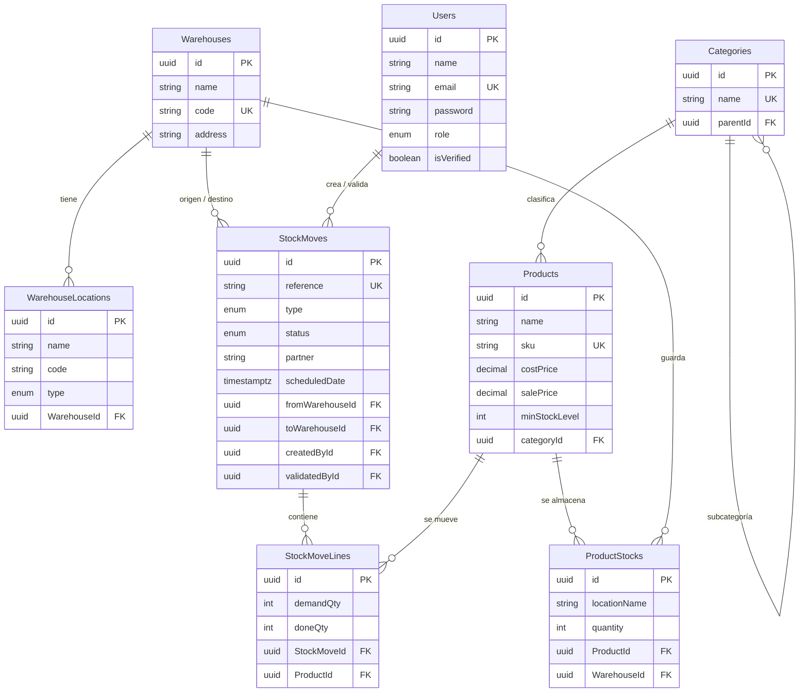

# CoreInventory — Migración a Supabase, persistencia web y dashboard en Looker Studio

Sistema web de gestión de inventario (bodegas, productos, recepciones, entregas, transferencias y ajustes).
Este repositorio es un fork del proyecto original [manthansingh26/Core-Inventory](https://github.com/manthansingh26/Core-Inventory),
adaptado para el trabajo **Migración a Supabase, Persistencia Web y Visualización con Looker Studio**.

## Qué se hizo

| Fase | Resultado |
|---|---|
| 1. Auditoría del modelo | 8 tablas normalizadas con claves primarias, foráneas y reglas `ON DELETE` / `ON UPDATE`. El `schema.sql` original estaba desactualizado (faltaban columnas de perfil y verificación); se corrigió. |
| 2. Supabase | Proyecto en Supabase, esquema creado con `schema.sql`, índices, RLS activado y datos poblados con `seed.sql`. |
| 3. Persistencia | El backend (Express + Sequelize) opera directamente sobre Supabase. Se activó SSL y se desactivó `sync({ alter: true })`: el esquema lo gestiona `schema.sql`. |
| 4. Looker Studio | Informe conectado a Supabase con un usuario de solo lectura (`looker_ro`): 4 tarjetas de KPIs, gráfico de barras, gráfico circular y 2 filtros dinámicos. |
| 5. Integración | El informe está incrustado con un `<iframe>` responsivo en la página principal (`client/src/pages/DashboardFixed.jsx`). |

## Tecnologías

- **Frontend:** React + Vite
- **Backend:** Node.js + Express + Sequelize
- **Base de datos:** PostgreSQL en Supabase
- **Analítica:** Google Looker Studio

## Estructura

```
client/                  Frontend (React + Vite)
server/
  schema.sql             Creación de tablas, índices y RLS
  seed.sql               Datos iniciales (50 movimientos, 30 productos, etc.)
  analytics.sql          Vistas de analítica y usuario de solo lectura para Looker
  .env.example           Plantilla de variables de entorno
  src/                   API (rutas, modelos, configuración)
```

## Ejecución local

### Requisitos
- Node.js 18 o superior y Git
- Una cuenta de Supabase

### 1. Clonar e instalar

```bash
git clone https://github.com/JohnDeivid12/Core-Inventory.git
cd Core-Inventory
cd server && npm install
cd ../client && npm install
```

En Windows, si el clon falla con `Filename too long`, ejecuta antes `git config --global core.longpaths true`.

### 2. Preparar Supabase

1. Crea un proyecto en [supabase.com](https://supabase.com).
2. Abre **SQL Editor** y ejecuta, en este orden, el contenido de:
   1. `server/schema.sql`
   2. `server/seed.sql`
   3. `server/analytics.sql` (antes, cambia `CAMBIA_ESTA_CLAVE` por una clave para el usuario `looker_ro`)
3. En **Connect** → **Session pooler** copia el host, el puerto y el usuario.

> Se usa el *Session pooler* porque la conexión directa de Supabase usa IPv6.

### 3. Variables de entorno

Copia `server/.env.example` como `server/.env` y completa `DB_PASS` con la contraseña de tu base de datos.
El archivo `client/.env` ya incluye `VITE_API_URL=http://localhost:5000/api`.

### 4. Arrancar

```bash
# Terminal 1
cd server
npm run dev

# Terminal 2
cd client
npm run dev
```

Abre `http://localhost:5173`.

### Usuarios de prueba

Todos con la contraseña `Password123`:

| Correo | Rol |
|---|---|
| laura.gomez@coreinventory.test | admin |
| carlos.ramirez@coreinventory.test | manager |
| diego.herrera@coreinventory.test | manager |
| andres.torres@coreinventory.test | staff |
| sofia.martinez@coreinventory.test | staff |

> Si registras un usuario nuevo, la aplicación muestra el código OTP de verificación en pantalla (modo desarrollo). También se puede leer en la columna `verificationOtp` de la tabla `Users`.

## Modelo de datos (DER)



### Reglas de integridad

- `ON DELETE CASCADE`: líneas de movimiento, ubicaciones y stock se eliminan junto con su movimiento, bodega o producto.
- `ON DELETE SET NULL`: al borrar una categoría, un usuario o una bodega, los registros que la referencian se conservan.
- Índices en claves foráneas y en `StockMoves(type, status)` y `StockMoves(scheduledDate)` para las consultas del dashboard.
- RLS activado en todas las tablas: la API pública de Supabase no puede leerlas.

### Datos de ejemplo (`seed.sql`)

| Tabla | Registros |
|---|---|
| Users | 5 |
| Warehouses | 4 |
| WarehouseLocations | 12 |
| Categories | 10 |
| Products | 30 |
| ProductStocks | 45 |
| StockMoves | 50 (abril – octubre de 2026) |
| StockMoveLines | 106 |

Las cantidades de `ProductStocks` se calcularon simulando los movimientos completados, por lo que son coherentes con el historial.

## Acceso a la base de datos (Supabase)

| Parámetro | Valor |
|---|---|
| Host (Session pooler) | `aws-1-us-west-2.pooler.supabase.com` |
| Puerto | `5432` |
| Base de datos | `postgres` |
| Usuario | `postgres.qwgkfxrsxwvqtdksqgfg` |
| Contraseña | *Entregada por separado, no se publica en el repositorio* |
| SSL | Requerido (`DB_SSL=true`) |

Para Looker Studio se usa un usuario de **solo lectura**:

| Parámetro | Valor |
|---|---|
| Usuario | `looker_ro.qwgkfxrsxwvqtdksqgfg` |
| Contraseña | *Entregada por separado* |
| Permisos | `SELECT` sobre las 7 tablas de negocio y las vistas `analytics.v_movimientos` y `analytics.v_stock`. Sin acceso a `Users`. |

## Dashboard en Looker Studio

- **Fuentes de datos:** una por tabla, creadas con consulta personalizada (`SELECT * FROM public."NombreTabla"`). Los nombres de las tablas llevan mayúsculas y deben ir entre comillas, de lo contrario PostgreSQL los convierte a minúsculas y el conector falla.
- **Combinaciones:** `Movimientos` (StockMoveLines + StockMoves + Products + Categories) e `Inventario` (ProductStocks + Products + Warehouses + Categories).
- **Gráficos:** tarjetas de KPIs (stock total, movimientos completados, unidades recibidas y entregadas), barras (unidades por categoría y tipo) y circular (movimientos por estado).
- **Filtros:** lista desplegable por tipo de movimiento y lista desplegable por categoría.
- **Incrustación:** `<iframe>` responsivo en `client/src/pages/DashboardFixed.jsx`, con acceso de lector para cualquiera que tenga el enlace.
- **Actualización de datos:** las fuentes se refrescan cada 12 horas para no agotar el límite de 15 conexiones del Session pooler.

Informe incrustado: https://datastudio.google.com/embed/reporting/bb6668de-340f-46a4-aff4-ae316e768427/page/bP1AG

## Despliegue y video

- **Aplicación desplegada:** _pendiente_
- **Video demostrativo:** _pendiente_

## Créditos

Proyecto base: [manthansingh26/Core-Inventory](https://github.com/manthansingh26/Core-Inventory).
